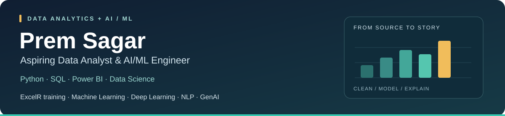

  

  <a href="https://digital-portfolio-builder.vercel.app/"><b>Portfolio</b></a> &nbsp;·&nbsp;
  <a href="https://www.linkedin.com/in/premsagar123"><b>LinkedIn</b></a> &nbsp;·&nbsp;
  <a href="mailto:premsagarsingara39@gmail.com"><b>Email</b></a>

I'm **Prem Sagar**, a B.Tech graduate with **Data Science training at ExcelR**. I'm preparing for **Data Analyst, AI Engineer, and ML Engineer** roles, combining an analytics portfolio with coursework in machine learning, deep learning, natural language processing, and generative AI.

**Career interests: Data Analytics · Artificial Intelligence · Machine Learning**

## Featured analytics projects

| Project | Scope and business questions | Evidence |
| :--- | :--- | :--- |
| **[Customer Analytics](https://github.com/premsagar39/customer-intelligence-revenue-analytics)** | Checked **1.067 million source rows**; analyzed returns, RFM segments, repeat purchasing and customer cohorts. | GBP 19.01m net revenue · top customer decile accounts for 63.93% of identified spend |
| **[Loan Portfolio Analytics](https://github.com/premsagar39/banking-credit-risk-loan-portfolio-analytics)** | Analyzed **2.26 million accepted loans**; compared grade, vintage and resolved-loan outcomes with maturity limitations documented. | USD 34.00bn funded · 19.98% charged-off share among resolved loans |
| **[Retail Demand Forecasting](https://github.com/premsagar39/retail-sales-demand-inventory-analytics)** | **3.00 million sales records**, 54 stores and 33 families; four forecasting models with chronological validation and labeled inventory scenarios. | 9.58% pooled / 22.12% macro-family WAPE on a separate 16-day holdout |

Each repository includes reproducible code, metric definitions, aggregate results, dashboard previews and editable Power BI source. Each of these three projects now includes **21 SQL analyses and 26 DAX measures**, plus a focused comparison page: customer-weighted RFM spend benchmarks, selected-vintage outcome and coverage gaps, or family-level forecast bias and error review. The reports have distinct themes, filters and contextual tooltips. The loan study is descriptive portfolio analysis; it does not claim a loan-origination prediction model.

## Zomato Restaurant Insights

**9,551 restaurants · 15 countries · 5 report pages · 43 DAX measures**

Which cities and cuisines dominate the sample, and where do highly voted restaurants lack online delivery?

- Built a restaurant–cuisine model, selected-market benchmarks, interactive filters, and contextual tooltips.
- Identified **1,762 restaurants with 100+ votes and no online delivery**, an exploratory service-coverage segment.
- Documented measure definitions, data checks, refresh steps, and interpretation limits.

**[Explore the project →](https://github.com/premsagar39/zomato-power-bi-dashboard)** · [Open the PBIX](https://github.com/premsagar39/zomato-power-bi-dashboard/blob/main/dashboard/Zomato_Insights.pbix) · [Read the DAX](https://github.com/premsagar39/zomato-power-bi-dashboard/blob/main/dax/measures.dax)

## Dashboard gallery

The four Power BI reports include page navigation, collapsible filters, metric and ranking views, contextual tooltips, drillthrough details, and light/dark theme files.

<table>
<tr>
<td width="50%"><a href="https://github.com/premsagar39/customer-intelligence-revenue-analytics"><b>Customer Analytics</b> </a></td>
<td width="50%"><a href="https://github.com/premsagar39/banking-credit-risk-loan-portfolio-analytics"><b>Loan Portfolio Analytics</b> </a></td>
</tr>
<tr>
<td width="50%"><a href="https://github.com/premsagar39/retail-sales-demand-inventory-analytics"><b>Retail Demand Forecasting</b> </a></td>
<td width="50%"><a href="https://github.com/premsagar39/zomato-power-bi-dashboard"><b>Zomato Restaurant Insights</b> </a></td>
</tr>
</table>

## More projects

| Project | Analysis focus | Review the work |
| :--- | :--- | :--- |
| **[Superstore Sales](https://github.com/premsagar39/bussiness-insights-sales-dashboard)** | Sales, profit, discounts, and shipping using MySQL and Power BI. | [SQL queries](https://github.com/premsagar39/bussiness-insights-sales-dashboard/tree/main/queries) |
| **[Telecom Customer Churn](https://github.com/premsagar39/telecom-Customer-Churn-Analysis)** | Python EDA of tenure, contracts, billing, and churn. | [Jupyter notebook](https://github.com/premsagar39/telecom-Customer-Churn-Analysis/blob/main/notebooks/Customer_Churn_Analysis.ipynb) |
| **[Coffee Shop Sales](https://github.com/premsagar39/coffee-shop-sales-excel-dashboard)** | Spreadsheet dashboard covering sales, product categories, and time trends. | [Dashboard preview](https://github.com/premsagar39/coffee-shop-sales-excel-dashboard/blob/main/coffee%20sales%20dashboard%20.png) |
| **[HR Analytics](https://github.com/premsagar39/HR-Analytics-Dashboard)** | Tableau dashboard exploring attrition and workforce patterns. | [Dashboard preview](https://github.com/premsagar39/HR-Analytics-Dashboard/blob/main/hr%20analytics%20dashboard.png) |
| **[Diwali Sales](https://github.com/premsagar39/diwali-sales-analysis-powerbi)** | Power BI analysis of customer segments, products, and regional sales. | [Repository and PBIX](https://github.com/premsagar39/diwali-sales-analysis-powerbi) |

## Data Science and AI/ML training

My ExcelR training has covered **Machine Learning, Deep Learning, Natural Language Processing (NLP), and Generative AI**. These topics extend my Python and data-analysis foundation toward AI/ML engineering. The projects linked above demonstrate my completed analytics work.

## Tools and knowledge

| Area | Tools and techniques |
| :--- | :--- |
| **Business intelligence** | Power BI, DAX, Power Query, data modeling, Tableau |
| **SQL analysis** | MySQL, joins, aggregations, subqueries, window functions |
| **Spreadsheet reporting** | Excel, pivot tables, charts, KPI summaries |
| **Exploratory analysis** | Python, pandas, NumPy, Matplotlib, Seaborn |
| **AI/ML coursework at ExcelR** | Machine Learning, Deep Learning, NLP, Generative AI |

I focus on checking the data, defining metrics clearly, and distinguishing observed patterns from assumptions. My repositories contain the dashboards, queries, notebooks, and supporting files behind the analysis.

**[View my portfolio](https://digital-portfolio-builder.vercel.app/)** · **[Connect on LinkedIn](https://www.linkedin.com/in/premsagar123)** · **[Contact me](mailto:premsagarsingara39@gmail.com)**
